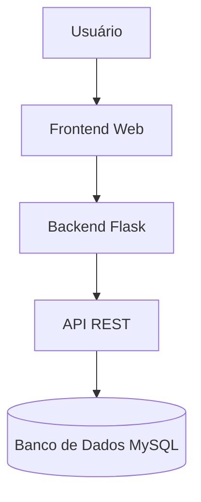
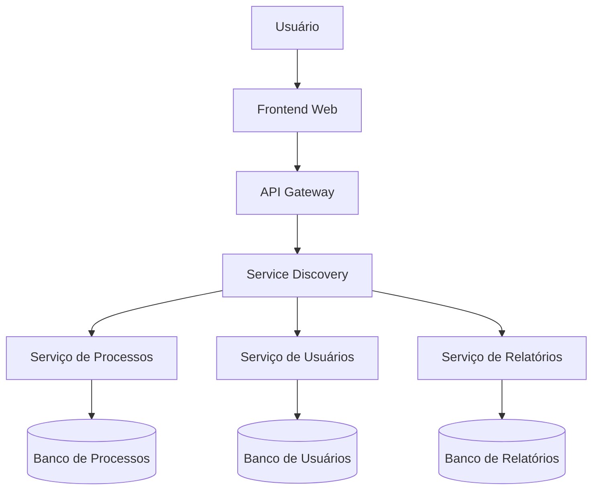

# PI - Monitoramento de Processos

Sistema de monitoramento e gestão de processos administrativos e organizacionais.

## 1. Sobre o projeto

O Sistema de Monitoramento de Processos tem como objetivo facilitar o cadastro, a consulta, a edição e a exclusão de processos, permitindo organizar informações por tipo e setor responsável.

## 2. Tecnologias utilizadas

- Python
- Flask
- HTML
- CSS
- JavaScript
- MySQL
- Git e GitHub

## 3. Arquitetura atual do sistema

A versão desenvolvida utiliza o modelo Cliente/Servidor, com comunicação entre frontend e backend por meio de uma API REST.

## 4. APIs disponíveis

| Método | Endpoint | Finalidade |
|---|---|---|
| GET | /api/processos | Consultar processos |
| POST | /api/processos | Cadastrar processo |
| PUT | /api/processos/id | Atualizar processo |
| DELETE | /api/processos/id | Excluir processo |

## 5. Proposta de evolução para microsserviços

Como possibilidade de evolução, propõe-se a separação das funcionalidades em serviços independentes, com gerenciamento das requisições por meio de um API Gateway e localização dos serviços por Service Discovery.

**Observação:** a arquitetura de microsserviços apresentada é uma proposta futura. A versão atual utiliza uma aplicação centralizada em Flask e um banco de dados MySQL.
